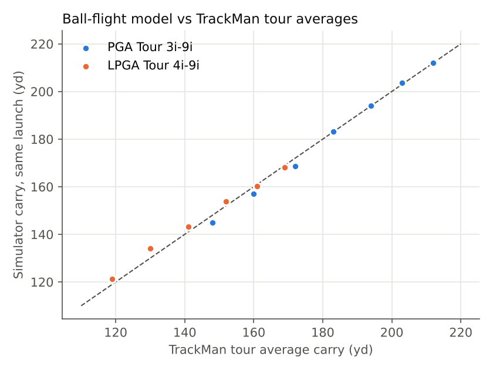
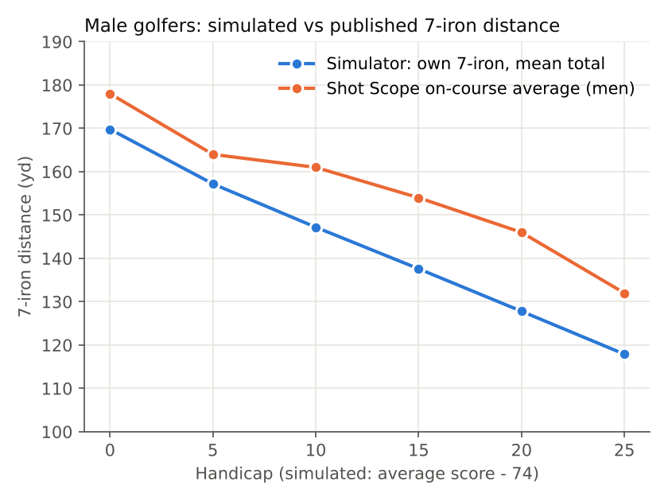
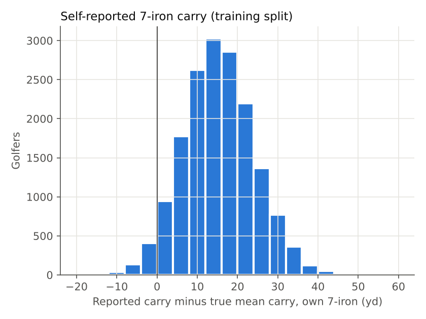
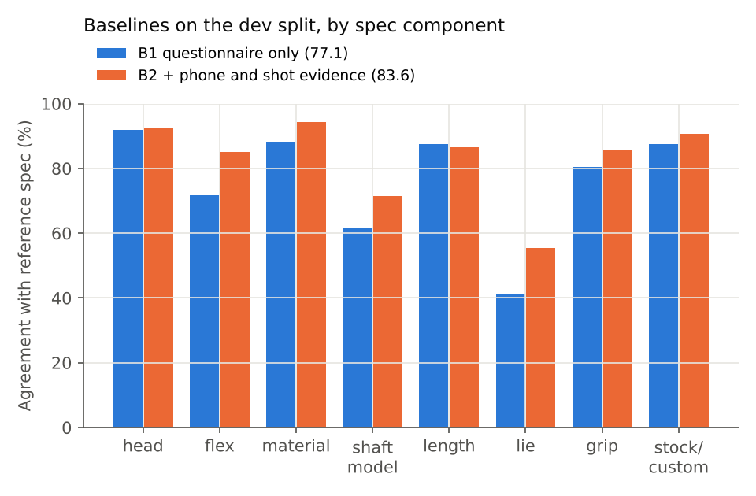

# How the synthetic data is made, and how far to trust it

Every golfer is generated in four layers: a **true golfer**, the **fitting they need**, the **evidence** they could give, and the **shots** they hit. The physics and the fitting rules ship with the pack (`takomo_fit/`). The population generator and its random seed stay with the organisers, so the hidden test labels cannot be regenerated.

## 1. Shot physics (`takomo_fit/physics.py`)

**Impact.** Club speed, dynamic loft, attack angle, face, path and strike location give ball speed, launch, spin and spin axis:

- smash factor falls with spin loft (dynamic loft minus attack angle) and with distance from the sweet spot; less forgiving heads lose more on mishits (scaled by Takomo's forgiveness rating);
- launch = 0.80 × dynamic loft + 0.10 × attack angle;
- spin rises with club speed and spin loft; low strikes add spin;
- start direction = 75 % face, 25 % path; spin-axis tilt from face-to-path (D-plane approximation) plus a gear effect for toe and heel strikes;
- a lie error tilts the lofted face: a toe-up club points left by atan(tan(loft) · sin(lie error)).

**Flight.** 3D drag and Magnus lift with spin decay, integrated with RK4. Drag and lift coefficients were fitted to TrackMan's published tour iron averages (PGA Tour 3-iron to 9-iron, LPGA Tour 4-iron to 9-iron): given the tour launch conditions, simulated carry is within **1.7 yd on average and 4.0 yd at worst** (figure 1). Landing angles come out about 3° shallower than TrackMan's 7-iron figures. Roll is a simple empirical model.

## 2. The true golfer

| Trait | Assumption |
|---|---|
| Sex, age | 24 % women; age around 50 ± 15 (18–85) |
| Handedness | 9 % left-handed |
| Skill | average 18-hole score 90 ± 9: about 2 % under 71, 6 % 71–77, 18 % 78–84, 34 % 85–92, 41 % over 92 |
| 7-iron speed | men: 79 mph at a score of 88, +0.6 mph per stroke better, −0.22 mph per year over 45, ±4.5 mph; women 80 % of that |
| Delivery | better players deliver less dynamic loft, a steeper attack and centre strikes more often; higher scores bring more open faces, out-to-in paths and wider dispersion |
| Height | men 179 ± 7 cm, women 166 ± 6.5 cm |
| Wrist-to-floor | 0.4855 × height + 2.0 cm ± 2.2 cm (in golf shoes). The 0.485 ratio is the classic Drillis–Contini wrist-height proportion; the constant puts Takomo's 173 cm example at its stated 86 cm |
| Hand length | 0.108 × height ± 0.55 cm (Drillis–Contini hand proportion). Glove-size edges are set so the population reproduces Takomo's real grip mix: 35 % standard, 52 % midsize, 13 % oversize |
| Finger length | middle finger 0.435 × hand length ± 0.25 cm (assumption) |
| Tempo | backswing 0.95 ± 0.14 s, slightly quicker for faster swingers; backswing:downswing ratio 3.4 ± 0.45 (tour players cluster near 3:1, amateurs higher) |
| Lie need | the static chart value plus a personal delivery offset ± 1.0°: hands higher or lower at impact than at address |
| Own 7-iron | loft 31 ± 1.8° (27–36), lie and length close to standard but unknown to the golfer |
| Priorities | 2–3 characteristics, drawn by skill: low scorers lean to workability and feel, high scorers to forgiveness and distance |

Figure 2 compares the simulated men's 7-iron distance by handicap with Shot Scope's on-course averages as published on Takomo's own blog. The simulator runs 7–18 yd shorter. Part of that is expected (on-course totals include fairway roll and are self-tagged), part is our assumption. If Takomo's data says amateurs hit further, the speed assumption is the one to raise.

## 3. The fitting the golfer needs (the labels)

Today's rules (`takomo_fit/baseline.py`) applied to the golfer's **true** values:

- score bucket from the true average score; swing bucket from the true 7-iron speed;
- desired ball flight = the trajectory the golfer actually needs: with a 31° reference 7-iron, landing steeper than 45° is `low`, shallower than 35° is `high`;
- tempo, height, wrist-to-floor and glove size: the true values;
- lie: the golfer's delivered need rounded to 1°, not the static chart. This is the single place where the reference deliberately goes beyond today's tool, because the pack says real-shot evidence is what a fitter trusts.

Distribution of the reference spec over all 28,016 golfers: head 101 MKII 50 %, 201 MKII 24 %, 201T MKII 14 %, 301 CB 11 %, 301 MB 2 %; flex regular 40 %, senior 28 %, stiff 20 %, ladies 11 %, extra stiff 2 %; steel 56 %; length standard 57 %; lie standard 26 %; grip standard 35 %, midsize 52 %, oversize 13 % (Takomo's real mix); **stock set 9.4 %**.

Most custom builds come from lie (74 % of golfers need a non-standard lie under the PING-style chart plus their delivery) and from graphite shafts (44 %).

## 4. The evidence

**Self-reports** (`questionnaire.csv`):

- score: 85 % report about 2.5 strokes better than their average;
- speed or carry: better players are likelier to know their speed (5–45 %); reported speed runs about 2 mph high. Reported carry is a remembered good shot with roll, somewhere between the golfer's median and best total, ± 7 yd, rounded to 5 yd. Median over-report against true mean carry: **15 yd** (figure 3). Combined with brand loft differences, the speed-or-carry answer lands in the right bucket for 57 % of golfers;
- flight and tempo: golfers scoring over 92 often answer at random (right 46 % for flight, 52 % for tempo); others are right about 68 % (flight) and 73 % (tempo) of the time, otherwise one step off;
- height: about 1 cm tall; 30 % answer in feet and inches;
- wrist-to-floor: ± 3 cm, and 15 % add a systematic 2.5–4 cm error (measured without shoes, or to the wrong landmark); 7 % end up more than 6 cm off;
- glove: 65 % right, 30 % one size off, 5 % two; 10 % do not know.

**Phone and home tests**: error levels are in `DATA_DICTIONARY.md`. About 70 % have a body photo, 64 % a hand photo, 84 % a swing video (34 % of all golfers at 240 fps), 20 % a ball-line test and 20 % an impact-spray test.

**Launch monitor**: about 25 % have a TrackMan fitting session and 15 % a home radar; per-shot measurement noise is added on top of the swing's own shot-to-shot variation.

## 5. Baselines

## 6. Limitations

- One club. Everything is a 7-iron; the rest of the set and the full bag are not simulated.
- No turf: fat and thin shots exist only as low strikes and mishit loss.
- Shaft effects (flex mismatch, weight, launch profile) and grip-size effects are small first-order models of fitting conventions, not measurements.
- Self-report and phone-error models are assumptions informed by the pack's own list of what golfers get wrong. They are plausible, not measured.
- The static lie chart approximates PING's colour code chart with a plane. It reproduces Takomo's five examples and six published PING examples, but the corners of the real chart may differ.
- A model that wins here has shown it can recover the truth under these assumptions. Showing that it agrees with a professional fitter needs real golfers: use the event recordings.
